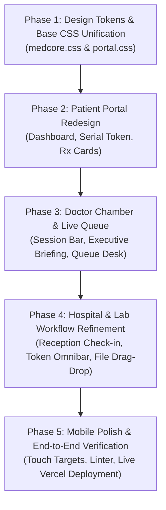

# MedCore — Comprehensive UI/UX Design & Implementation Plan
> **Document Code:** `MEDCORE-UI-PLAN-2026`  
> **Core Principle:** *"Less Text, More Visual Understanding"* (কম লেখা, চোখের পলকে সর্বোচ্চ তথ্য ও সার্বিক নিয়ন্ত্রণ)  
> **Target Audience:** Patients, Specialist Doctors, Hospital Administrators, Diagnostic Lab Technicians, System Admins, Emergency Responders.

---

## 📑 Table of Contents
1. [Design Philosophy: Less Text, More Visual Understanding](#1-design-philosophy)
2. [Global Design System & Role-Based Color Palette](#2-global-design-system--branding)
3. [Post-Login Interface Architecture by Portal](#3-post-login-interface-architecture)
   - [3.1 Patient Portal (`/patient/`)](#31-patient-portal)
   - [3.2 Doctor Portal (`/doctor/`)](#32-doctor-portal)
   - [3.3 Hospital Admin Portal (`/hospital/`)](#33-hospital-admin-portal)
   - [3.4 Diagnostic Laboratory Portal (`/lab/`)](#34-diagnostic-laboratory-portal)
   - [3.5 System Admin Portal (`/admin/`)](#35-system-admin-portal)
   - [3.6 Public Directory & Emergency First-Responder](#36-public-directory--emergency-interfaces)
4. [Component Library & Visual-First Patterns](#4-component-library--visual-first-patterns)
5. [Mobile Responsiveness & Touch UX Strategy](#5-mobile-responsiveness--touch-ux)
6. [Step-by-Step Implementation Roadmap](#6-step-by-step-implementation-roadmap)

---

## 1. Design Philosophy: Less Text, More Visual Understanding

### 🎯 The Core Problem in Current Healthcare Software
Typical hospital and EHR systems present dense, monotonous tables filled with raw database text, confusing medical abbreviations, and multi-step hidden menus. In a busy OPD consultation chamber or an emergency hospital lobby in Bangladesh:
- **Patients** struggle to understand complex diagnostic reports, lose paper prescriptions, and miss their queue numbers.
- **Doctors** waste valuable consultation minutes reading long walls of text instead of instantly spotting critical allergies, current medications, and past diseases.
- **Hospital Receptions** face chaotic waiting lobbies with manual paper tokens and unclear queue status.
- **Diagnostic Labs** struggle to verify handwritten test slips.

### 💡 MedCore's Visual-First Solution
MedCore replaces text clutter with **instant visual cognition**:
1. **Color-Coded Status & Urgency:** Green for Normal/Confirmed, Amber for Waiting/Pending, Crimson for Severe Allergies / STAT Emergency, Blue for Active Sessions.
2. **Visual Tokens & Badges:** Large, high-contrast queue numbers (`#01`, `#02`), Short Lab Tokens (`LT-XK9F2`), and blood group icons that can be verified in 0.5 seconds.
3. **Card-Based & Grid-Based Layouts:** Replace wide, unreadable horizontal data tables with responsive modular cards that display hierarchy: **Primary Metric -> Secondary Details -> Quick Action Button**.
4. **Bilingual Micro-Copy (English + Bengali):** English clinical standards paired with clear Bengali labels (`রোগী সিরিয়াল`, `খাবার পর`, `ল্যাবের টোকেন`, `রোগী দেখুন`) so patients of any literacy level understand their treatment.
5. **Persistent Contextual Banners:** When a doctor is viewing a patient's record, a high-visibility session bar stays sticky at the top, showing the active patient's name, countdown timer, and 1-click end session button.

---

## 2. Global Design System & Role-Based Color Palette

### 🎨 Portal Color Identity
Each portal has a distinct primary accent color, ensuring users instantly know their operational context:

| Portal | Primary Accent | Accent Hex | Background / Glass Tint | Mood & Purpose |
|---|---|---|---|---|
| **Patient** | Health Azure Blue | `#0284C7` / `#2563EB` | Soft Light (`#F8FAFC`) | Clean, calming, empowering personal health record |
| **Doctor** | Clinical Stethoscope Teal | `#0D9488` / `#0F766E` | Slate Crisp (`#F1F5F9`) | High-focus, distraction-free clinical environment |
| **Hospital** | Deep Navy / Corporate Teal | `#1E3A8A` / `#0284C7` | Neutral Professional | Operational efficiency, reception desk, resource management |
| **Diagnostic Lab** | Electric Violet / Neon Indigo | `#7C3AED` / `#6366F1` | Dark Slate & Clean Cards | High-tech diagnostic lab, barcode/token scanning feel |
| **System Admin** | Midnight Slate & Gold | `#0F172A` / `#F59E0B` | Deep Enterprise | Regulatory governance, BMDC licensure verification |
| **Emergency ICE**| Vivid Alert Red | `#DC2626` / `#EF4444` | High Contrast Emergency | Instant visibility for trauma responders and paramedics |

### 🔤 Typography & Contrast Standards
- **Primary Font:** `Inter`, `-apple-system`, `sans-serif` (clean, highly legible numerals and Bengali unicode glyphs).
- **Code & Token Font:** `JetBrains Mono`, `Roboto Mono` (monospace for Serial `#04`, Token `LT-8K2A9`, BMDC `BMDC-A-12345`).
- **Hierarchy:**
  - Page Titles: `22px - 26px`, Bold `800`, Deep Slate (`#0F172A`).
  - Section Headings: `16px - 18px`, Semi-bold `700`.
  - Body Text: `14px - 15px`, Regular `400` / Medium `500`.
  - Micro-labels / Badges: `10px - 12px`, Bold `700`, uppercase with `0.5px` tracking.

---

## 3. Post-Login Interface Architecture by Portal

---

### 3.1 Patient Portal (`/patient/`)
*Primary Goal: Allow patients to instantly see their upcoming appointments, active medicines, lab test tokens, and emergency card in 1 screen.*

```
+-----------------------------------------------------------------------------------+
|  [M] MedCore Patient  |  Search...              |  [ICE Card] [Notifications (2)] |
+-----------------------+-----------------------------------------------------------+
| [Dashboard]           |  👋 Welcome, Rahat Mahamud (PT-000001) · O+ Positive      |
| Appointments (1)      +-----------------------------------------------------------+
| Prescriptions         |  🚨 CRITICAL HEALTH ALERT: Severe Penicillin Allergy      |
| Lab Reports           +-----------------------------------------------------------+
| Medications           |  [ 🎫 YOUR UPCOMING DOCTOR SERIAL ]                       |
| Medical History       |  #02  Dr. Farhana Rahman (Cardiology) · ABC Hospital       |
| Consent Requests (1)  |  Time: Today, 05:30 PM · Status: CONFIRMED · [Print Slip] |
| Profile & Settings    +-----------------------------------------------------------+
| [Log Out]             |  [ 🔬 ACTIVE LAB ORDERS & SHORT TOKENS ]                  |
|                       |  Token: [ LT-99B2A ] · 2 Tests Ordered · [Show QR / Code] |
|                       +-----------------------------------------------------------+
|                       |  [Active Prescriptions: 3] [Total Visits: 8] [Reports: 4] |
|                       +-----------------------------------------------------------+
|                       |  [ 💊 Current Medications ]  |  [ 🕒 Health Timeline ]    |
|                       |  - Tab. Napa Extra (1+0+1)   |  - 10 Nov: Cardiology OPD  |
|                       |  - Cap. Seclo 20mg (1+0+1)   |  - 02 Nov: Blood CBC Done  |
+-----------------------+-----------------------------------------------------------+
```

#### Key UI Elements After Login:
1. **Top Identity Banner:** Displays Patient Name, Unique ID (`PT-XXXXXX`), and Blood Group badge (`O+`) in high-contrast pill format.
2. **Critical Safety Alert (Red Bar):** If the patient has any `SEVERE` or `LIFE_THREATENING` allergy, it stays visible as an eye-catching warning badge at the top so any attending clinician or family member sees it immediately.
3. **Live Doctor Serial Card (Blue Gradient Box):**
   - High-visibility serial token `#02`.
   - Doctor Name, Specialization, and Hospital name.
   - Status badge: `বুকিং নিশ্চিত (Confirmed)` / `লবিতে অপেক্ষমান (Waiting)` / `ডাক্তার দেখছেন (In Consultation)`.
   - 1-click **"Print Token Slip (টোকেন স্লিপ প্রিন্ট)"** button.
4. **Active Lab Order Token Widget (Purple Glass Box):**
   - Shows the Short Lab Token (e.g. `LT-99B2A`) in large monospace font with a 1-click "Copy" button.
   - Progress bar: `1 of 2 tests completed`.
   - Direct note: *"Show this code at any hospital laboratory desk"*.
5. **Active Medications Card:**
   - Pill chips displaying medicine brand name, strength, and Bengali timing chip (`১+০+১ (খাবার পর)`).
6. **Recent Prescriptions Card:**
   - 1-click view and PDF download with official hospital watermark.

---

### 3.2 Doctor Portal (`/doctor/`)
*Primary Goal: Speed and clarity. A doctor must grasp a patient's core clinical picture in 10 seconds and manage the consultation queue effortlessly.*

```
+-----------------------------------------------------------------------------------+
|  [M] MedCore Doctor  |  Current: [ABC General Hospital ▾]  |  [Queue: 4] [Search] |
+-----------------------------------------------------------------------------------+
|  🔴 ACTIVE CONSULTATION: Rahat Mahamud (PT-000001) | ⏱️ 24:18 left | [End Session] |
+-----------------------------------------------------------------------------------+
| [Dashboard]           |  📋 EXECUTIVE CLINICAL BRIEFING                           |
| Live Queue (4)        |  Allergies: ⚠️ Penicillin (Severe) | Blood: O+ | Age: 28  |
| Patient Search        |  Active Dx: Hypertension, Peptic Ulcer                    |
| Create Rx             +-----------------------------------------------------------+
| Consultations         |  [ ⚡ QUICK ACTION BUTTONS ]                               |
| Switch Hospital       |  [+ New Prescription]  [+ Order Lab Test]  [Full History] |
| Profile & BMDC        +-----------------------------------------------------------+
| [Log Out]             |  [ TODAY'S LIVE QUEUE (4 Patients Waiting) ]              |
|                       |  [STAT] #01 - Karim Uddin (Chest Pain) -> [Call Patient]  |
|                       |  [NORM] #02 - Rahat Mahamud (Routine)   -> [In Session]   |
|                       |  [NORM] #03 - Nasima Begum (Follow-up)  -> [Call Patient] |
|                       +-----------------------------------------------------------+
|                       |  [ 🔍 EMERGENCY WALK-IN PATIENT LOOKUP ]                  |
|                       |  Enter NID / Phone / Patient UID -> [Add STAT Emergency]  |
+-----------------------------------------------------------------------------------+
```

#### Key UI Elements After Login:
1. **Persistent Top Session Bar (`session_bar.php`):**
   - When a patient's record is unlocked, a high-visibility session bar locks onto the screen.
   - Shows active patient name, Patient UID, blood group, remaining time countdown (`24:18`), and red **"End Consultation (সেশন সমাপ্ত)"** button.
   - Prevents accidental consultation overlap or leaving open records.
2. **Executive Clinical Summary Card (ডাক্তারের জন্য সারসংক্ষেপ):**
   - Instead of reading 10 pages of past notes, the doctor sees a single compact card:
     - **Critical Allergies:** Highlighted in red with warning icon.
     - **Current Active Medications:** Chips showing ongoing drugs.
     - **Past Major Diagnoses:** Last diagnosed conditions and when.
     - **Latest Key Vitals:** BP, Heart Rate, Blood Sugar.
3. **Live Consultation Queue (`/doctor/queue.php`):**
   - Automatically prioritizes **STAT Emergency** patients at the top of the queue.
   - Large serial badges `#01`, `#02`, `#03` with patient complaint summary.
   - 1-click **"Call Patient (রোগী দেখুন)"** button that automatically validates consent and loads the patient's record.
4. **Emergency Walk-In Omnibar:**
   - Quick input for Patient UID, Phone, or NID to pull emergency walk-in patients straight into the chamber without waiting for reception queues.
5. **Smart Prescription Builder (`/doctor/create-prescription.php`):**
   - 1-click Bengali dosage presets: `১+০+১ (খাবার পর)`, `১+১+১ (খাবার আগে)`, `জ্বর আসলে (SOS)`.
   - Medicine auto-complete with generic brand matching.
   - Lab test selector with urgency flags (`Routine`, `Urgent`, `STAT`) that automatically creates the unique Short Lab Token upon signing.

---

### 3.3 Hospital Admin Portal (`/hospital/`)
*Primary Goal: Total hospital floor oversight — managing affiliated doctors, diagnostic labs, daily OPD patient flow, and reception desks.*

```
+-----------------------------------------------------------------------------------+
|  [H] ABC General Hospital | Dhanmondi, Dhaka | [Active OPD Queue: 18 Patients]    |
+-----------------------+-----------------------------------------------------------+
| [Dashboard]           |  🏥 RECEPTION & OPD QUEUE DESK                            |
| Appointments & Queue  |  [Total: 24]  [Waiting Lobby: 12]  [In Room: 4] [Done: 8] |
| Affiliated Doctors(6) +-----------------------------------------------------------+
| Laboratories (2)      |  [ 🔍 RECEPTION CHECK-IN SEARCH ]                         |
| Departments (8)       |  Search by Appointment UID (APT-XXXX) or Phone...         |
| Consultations         +-----------------------------------------------------------+
| Diagnostics Register  |  [ LIVE QUEUE & CHECK-IN TABLE ]                          |
| Hospital Settings     |  #01 | APT-102 | Dr. Farhana | Karim Uddin | [Mark Arrived] |
| [Log Out]             |  #02 | APT-103 | Dr. Kamrul  | Rahat M.    | [Paid ৳1000]   |
|                       +-----------------------------------------------------------+
|                       |  [ DOCTOR AFFILIATIONS ]     |  [ ACCREDITED LABS ]       |
|                       |  - Dr. Farhana (Medicine)    |  - Apex Diagnostics (Active)|
|                       |  - Dr. Kamrul (Cardiology)   |  - Medinova Imaging (Active)|
|                       |  [+ Add / Affiliate Doctor]  |  [+ Affiliate Lab]         |
+-----------------------+-----------------------------------------------------------+
```

#### Key UI Elements After Login:
1. **Hospital OPD Reception Desk (`/hospital/appointments.php`):**
   - Live stream of all patients booked for today across all doctors.
   - Fast action buttons for hospital receptionists:
     - **"Mark Arrived / লবিতে উপস্থিত"**: Changes status to `WAITING`, notifying the doctor's live queue that the patient is in the lobby.
     - **"Collect Fee / পেমেন্ট গ্রহণ"**: Toggles payment from `UNPAID` to `PAID` with receipt slip generation.
2. **Daily Performance Stat Badges:**
   - 4 high-contrast KPI cards: Total Bookings, Waiting in Lobby, Currently in Consultation, Consultations Completed.
3. **Doctor Roster & Department Manager (`/hospital/doctors.php`):**
   - Visual cards showing doctor photo/avatar, BMDC number, specialty, and pending join requests with 1-click Approve/Reject.
4. **Diagnostic Laboratory Network (`/hospital/laboratories.php`):**
   - Shows affiliated pathology and radiology centers connected to the hospital's electronic lab order network.

---

### 3.4 Diagnostic Laboratory Portal (`/lab/`)
*Primary Goal: Extreme keyboard efficiency. Technician enters a token, sees exact tests requested by the doctor, and uploads verified results.*

```
+-----------------------------------------------------------------------------------+
|  [🔬] Apex Diagnostics | Affiliated: ABC General Hospital | [Today's Uploads: 14] |
+-----------------------+-----------------------------------------------------------+
| [Dashboard]           |  🎯 SHORT LAB TOKEN OMNIBAR SEARCH                        |
| Search Token          |  +-----------------------------------------------------+  |
| Upload Results        |  | Enter Token: [ LT - 9 9 B 2 A ]          [SEARCH ⏎] |  |
| Completed Reports     |  +-----------------------------------------------------+  |
| Lab Profile           |  Press Enter or Scan Barcode to instantly pull order      |
| [Log Out]             +-----------------------------------------------------------+
|                       |  🧪 ORDER DETAILS: Patient: Rahat Mahamud (Age: 28, Male) |
|                       |  Doctor: Dr. Farhana Rahman · Hospital: ABC Hospital      |
|                       +-----------------------------------------------------------+
|                       |  [ORDERED TESTS IN THIS TOKEN]                            |
|                       |  1. Complete Blood Count (CBC)   [STAT] -> [Upload Result]|
|                       |  2. Serum Creatinine             [ROUT] -> [Upload Result]|
|                       +-----------------------------------------------------------+
|                       |  [ FAST RESULT ENTRY MODAL ]                              |
|                       |  Numeric Value: [ 1.1 mg/dL ] | Normal Range: [0.7 - 1.3] |
|                       |  Status: (•) NORMAL   ( ) ABNORMAL   ( ) CRITICAL         |
|                       |  Attach PDF Report / Scan: [ 📁 Drag & Drop PDF here ]    |
|                       |  [ ✅ Submit & Auto-Sync to Patient Portal ]               |
+-----------------------+-----------------------------------------------------------+
```

#### Key UI Elements After Login:
1. **Hero Token Omnibar (`/lab/search-token.php`):**
   - Giant centered search input formatted for Short Lab Tokens (e.g. `LT-XXXXX`).
   - Supports barcode/QR scanner keyboard input.
2. **Order Breakdown Card:**
   - Instantly renders doctor's clinical notes, ordering hospital, patient demographics, and priority badge (`ROUTINE`, `URGENT`, `STAT EMERGENCY`).
3. **Fast Result Uploader (`/lab/upload-results.php`):**
   - Color-coded result classification:
     - **NORMAL** (Green chip)
     - **ABNORMAL** (Amber chip)
     - **CRITICAL** (Red pulsing chip)
   - PDF/Image attachment zone with instant thumbnail preview.
   - Instant synchronization to the patient's record upon submission.

---

### 3.5 System Admin Portal (`/admin/`)
*Primary Goal: National healthcare oversight, regulatory compliance, BMDC verification, and immutable audit logs.*

```
+-----------------------------------------------------------------------------------+
|  [🛡️] MedCore Central Administration | DGDA & BMDC Regulatory Authority           |
+-----------------------+-----------------------------------------------------------+
| [Dashboard]           |  🏛️ NATIONAL HEALTH OPERATIONS CENTER                     |
| Doctors Registry      |  [Verified Docs: 42] [Hospitals: 8] [Labs: 14] [Audits]   |
| Hospital Licensure    +-----------------------------------------------------------+
| Diagnostic Licensure  |  ⚠️ PENDING VERIFICATION QUEUE (Action Required)          |
| Platform Audit Logs   |  - Dr. Tariqul Islam | BMDC-A-9921 | Neuro  | [Verify] [X]|
| System Health         |  - Modern Diagnostic | Lic: LAB-8812 | Dhaka  | [Verify] [X]|
| [Log Out]             +-----------------------------------------------------------+
|                       |  [ REAL-TIME PLATFORM AUDIT FEED ]                        |
|                       |  14:22 - Consent Approved: PT-000001 -> DR-000001 (ABC)   |
|                       |  14:18 - Lab Result Uploaded: LT-99B2A by Apex Lab        |
|                       |  14:05 - Emergency Break-Glass: DR-000003 at City ER      |
+-----------------------+-----------------------------------------------------------+
```

#### Key UI Elements After Login:
1. **Verification Queue Cards:**
   - Pending doctor and diagnostic clinic licenses displayed with direct BMDC registration number lookup and 1-click Approve/Reject modals.
2. **Real-Time Audit Stream (`/admin/audit-logs.php`):**
   - Color-coded severity feed (Info = Blue, Warning = Amber, Emergency Break-Glass = Red) tracking every cryptographic consent, medical record access, and prescription creation.

---

### 3.6 Public Directory & Emergency Interfaces

#### 1. Public Online Doctor Booking Directory (`/book-doctor.php`)
- **Category Filter Pills:** Horizontal scrollable specialty badges (`Medicine`, `Cardiology`, `Pediatrics`, `Neurology`, `Gynecology`, `Orthopedics`).
- **Hospital Filter:** Filter doctors by hospital (e.g. ABC General Hospital).
- **Doctor Cards:**
  - High-resolution avatar and verified green checkmark.
  - Star rating score (`★ 4.9 (120+ reviews)`) and "Top Rated" badge.
  - Consultation fee tag (`৳১,০০০`).
  - Available consultation days & time slots.
  - 1-click **"Book Serial (সিরিয়াল বুক করুন)"** modal with automatic serial token generation.

#### 2. Emergency First-Responder ICE Profile (`/emergency.php?uid=PT-000001`)
- **Zero Login Required:** Designed for roadside accidents, paramedics, and first responders.
- **Red Emergency Header:** Patient Photo, Name, and giant Blood Group badge (e.g. **O+**).
- **Critical Life-Saving Data:**
  - Severe allergies (e.g., Penicillin, Anesthesia reactions).
  - Chronic conditions (Diabetes, Cardiac pacemaker, Epilepsy).
- **1-Click Emergency Contact Call:** Giant green button to instantly dial the patient's next-of-kin.

---

## 4. Component Library & Visual-First Patterns

To achieve *"Less Text, More Visual Understanding"*, the UI standardizes on the following 6 core visual components:

```
+----------------------------------------------------------------------------+
| 1. QUEUE SERIAL TOKEN BOX             | 2. SHORT LAB TOKEN BOX             |
|    +-----------------------------+    |    +-----------------------------+ |
|    |        QUEUE SERIAL         |    |    |       SHORT LAB TOKEN       | |
|    |            #01              |    |    |         LT-99B2A            | |
|    |      STAT EMERGENCY         |    |    |    [Copy]  [Show QR Code]   | |
|    +-----------------------------+    |    +-----------------------------+ |
+---------------------------------------+------------------------------------+
| 3. EXECUTIVE CLINICAL BRIEFING CARD   | 4. BILINGUAL DOSAGE PILLS          |
|    ⚠️ Penicillin (Severe Allergy)     |    [ ১+০+১ ] [ খাবার পর ]          |
|    🩸 Blood: O+  ·  Age: 28 M         |    [ ১+১+১ ] [ খাবার আগে ]         |
|    🫀 Hypertension (Since 2022)      |    [ ০+০+১ ] [ রাতে শোবার আগে ]    |
+---------------------------------------+------------------------------------+
| 5. PERSISTENT SESSION TIMER BAR       | 6. LAB RESULT STATUS CHIPS         |
|    🟢 Rahat M. (PT-001) | ⏱️ 28:15    |    [ NORMAL ]    [ ABNORMAL ]      |
|    [End Session / সেশন সমাপ্ত করুন]     |    [ 🚨 CRITICAL VALUE ]           |
+----------------------------------------------------------------------------+
```

### Visual Component Specifications:
1. **Queue Serial Token Box (`.token-box`):**
   - High-contrast gradient background (Blue for Routine, Red for STAT Emergency).
   - Massive 28px monospace serial number (`#01`).
   - Visible from 5 feet away on a nurse's mobile device or tablet.
2. **Short Lab Token Box (`.lab-token-card`):**
   - Dashed border with monospace uppercase token (`LT-XXXXX`).
   - One-touch copy and QR presentation for lab counters.
3. **Executive Clinical Briefing Card (`.executive-summary-card`):**
   - Placed at the very top of the doctor's consultation view.
   - Aggregates allergies, chronic conditions, and last consultation notes into 4 colored badge chips so the doctor never needs to manually search historical archives during a routine visit.
4. **Bilingual Dosage Chips (`.dosage-chip`):**
   - Clean clickable buttons with clear Bengali instructions for rapid prescription typing without spelling errors.
5. **Persistent Session Timer Bar (`.doctor-session-bar`):**
   - Sticky top bar with glowing timer indicator that turns amber when 5 minutes remain and red when expired.
6. **Lab Result Status Chips (`.status-pill`):**
   - Normal values in gentle green (`#10B981`), high/low values in warning amber (`#F59E0B`), and panic/critical values in pulsing crimson (`#EF4444`).

---

## 5. Mobile Responsiveness & Touch UX Strategy

Healthcare professionals and patients in Bangladesh overwhelmingly access web applications via mobile smartphones (Android/iOS). The design system enforces:

1. **Touch Target Size:** All buttons, pills, and navigation icons have a minimum clickable area of **`44px × 44px`** to eliminate misclicks on mobile touchscreens.
2. **Off-Canvas Navigation Drawer:**
   - On screens `< 768px`, the sidebar smoothly collapses off-canvas.
   - Toggled via a prominent hamburger button with touch backdrop overlay.
3. **Sticky Action Bottom Bar:**
   - In mobile doctor and patient consultation views, critical primary actions (e.g. *"Call Next Patient"*, *"Submit Prescription"*, *"End Session"*) lock to a sticky bottom bar above the phone's navigation controls.
4. **Responsive Card Grids (`grid-template-columns: repeat(auto-fit, minmax(280px, 1fr))`):**
   - Multi-column desktop grids stack gracefully into full-width mobile cards without horizontal scrolling.
5. **Print Stylesheets:**
   - Dedicated `@media print` CSS rules for Prescriptions and Serial Slips that strip away navigation sidebars, backgrounds, and buttons, rendering crisp black-and-white A4 slips.

---

## 6. Step-by-Step Implementation Roadmap



### Phase 1: Design Tokens & Base CSS Unification
- **Files:** `assets/css/medcore.css`, `assets/css/portal.css`.
- **Tasks:**
  - Define unified CSS custom properties for all 5 portal color themes.
  - Implement reusable utility classes: `.token-box`, `.status-pill`, `.executive-summary-card`, `.dosage-chip`.
  - Standardize modal dialogs and alert banners.

### Phase 2: Patient Portal Redesign (`/patient/`)
- **Files:** `patient/dashboard.php`, `patient/appointments.php`, `patient/prescriptions.php`, `patient/lab-reports.php`.
- **Tasks:**
  - Place the Live Serial Box and Active Lab Tokens at the top of the dashboard.
  - Add Critical Allergy warning banner.
  - Convert dense prescription lists into printable visual cards with QR watermarks.

### Phase 3: Doctor Portal & Chamber Workflow (`/doctor/`)
- **Files:** `doctor/dashboard.php`, `doctor/queue.php`, `doctor/medical-record.php`, `doctor/create-prescription.php`.
- **Tasks:**
  - Embed the Persistent Session Timer Bar (`doctor/includes/session_bar.php`).
  - Add the Executive Clinical Summary component to the patient record screen.
  - Refine the Live Consultation Queue with STAT Emergency priority sorting and 1-click "Call Patient" buttons.
  - Add 1-click Bengali dosage presets to prescription authoring.

### Phase 4: Hospital & Laboratory Portals (`/hospital/` & `/lab/`)
- **Files:** `hospital/appointments.php`, `hospital/dashboard.php`, `lab/search-token.php`, `lab/upload-results.php`.
- **Tasks:**
  - Build the Reception Check-In Desk interface for arriving OPD patients.
  - Build the fast Short Lab Token lookup omnibar with instant test breakdown.
  - Implement Normal/Abnormal/Critical status chips on diagnostic result entries.

### Phase 5: Verification, Verification Testing & Live Cloud Push
- **Tasks:**
  - Run full PHP syntax linter across all files (`php -n -l`).
  - Run end-to-end Python integration tests.
  - Synchronize SQLite binaries (`api/`, `public/`, `app/config/`, `database/`).
  - Commit and push to GitHub repository via `scratch/push.ps1`.
  - Verify live HTTP 200 responses on `https://medcore1-tan.vercel.app/`.

---

## 7. Summary of User Deliverables

| Requirement | Implementation Artifact | Live URL |
|---|---|---|
| **Design Plan & Specs** | `docs/UI_UX_DESIGN_AND_IMPLEMENTATION_PLAN.md` | In Repository |
| **Online Doctor Booking** | `public/book-doctor.php` & `book-doctor.php` | [Book Doctor Live](https://medcore1-tan.vercel.app/book-doctor.php) |
| **Doctor Live Queue** | `doctor/queue.php` & `doctor/dashboard.php` | [Doctor Queue](https://medcore1-tan.vercel.app/doctor/queue.php) |
| **Patient Appointments** | `patient/appointments.php` & `patient/dashboard.php`| [Patient Portal](https://medcore1-tan.vercel.app/patient/login.php) |
| **Hospital Reception Desk**| `hospital/appointments.php` | [Hospital Desk](https://medcore1-tan.vercel.app/hospital/appointments.php) |
| **Emergency ICE Card** | `emergency.php?uid=PT-000001` | [Emergency Profile](https://medcore1-tan.vercel.app/emergency.php?uid=PT-000001) |
